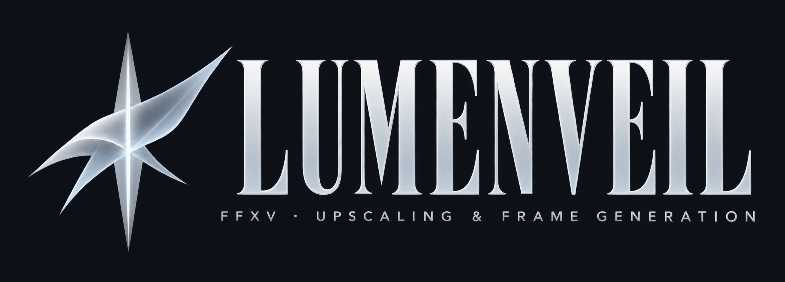
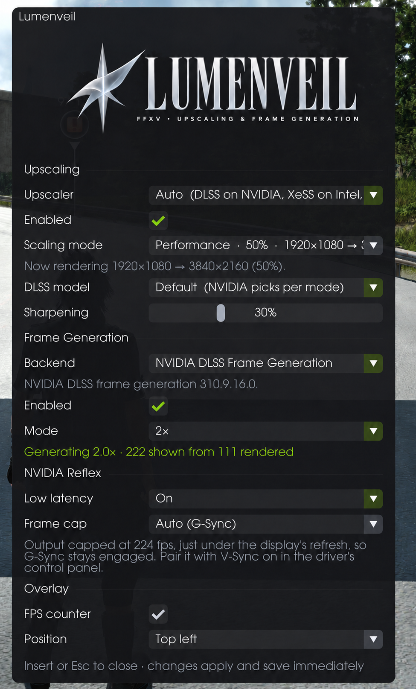
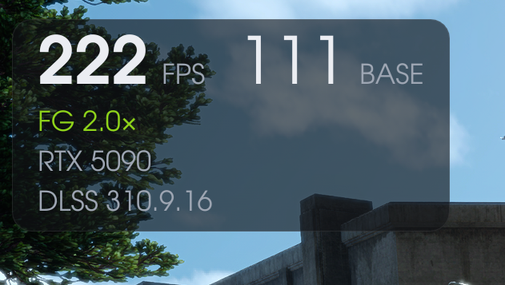

<p align="center">
  <picture>
    <source media="(prefers-color-scheme: dark)" srcset="docs/images/logo-transparent.png">
    
  </picture>
</p>

<p align="center">
  <b>Current DLSS, FSR and XeSS, with frame generation and low latency, for FINAL FANTASY XV WINDOWS EDITION.</b><br>
  Windows and Linux (Steam Proton). No changes to the game's files.
</p>

<p align="center">
  <a href="https://github.com/itslukebond/lumenveil/releases/latest"><b>Download the latest release</b></a>
  (the <code>lumenveil-&lt;version&gt;.zip</code> file under Assets)
</p>

https://github.com/user-attachments/assets/4d549f08-57ef-4710-8c7c-9c15e43cc003

<p align="center">
  <sub>4K, DLSS Performance, 3x frame generation, 240 fps from an 80 fps base (recorded on Linux)</sub>
</p>

---

## Contents

- [Why this mod exists](#why-this-mod-exists)
- [Features](#features)
- [Requirements](#requirements)
- [Install](#install)
- [Using the mod (Insert key)](#using-the-mod-insert-key)
- [Uninstall](#uninstall)
- [Known issues](#known-issues)
- [Building from source](#building-from-source)
- [Licence](#licence)

---

## Why this mod exists

FFXV on PC was one of the very first games to ship with DLSS. That was **DLSS 1**, and if you tried it back then you'll
remember how soft and smeary it looked, especially on hair and foliage. It only worked at 4K as well. Square Enix
stopped updating the PC version not long after, so it never got moved to DLSS 2 like a lot of other early games did,
and it never got AMD's FSR or Intel's XeSS at all.

I wanted to play through FFXV again on my new PC, and it bugged me that one of the first DLSS games was stuck with the
worst version of it. So I had a go at fixing it myself. Once the game could feed a modern upscaler, there was no reason
to stop at NVIDIA, so the mod runs DLSS, FSR or XeSS, whichever suits your card.

### Why can't you just swap the DLL?

For most DLSS games you can drop a newer `nvngx_dlss.dll` into the game folder (DLSS Swapper does this) and get the
latest model, and tools like OptiScaler use the same hook to run FSR or XeSS instead. That works because every game
from DLSS 2 onwards talks to the upscaler in the same way, so a newer DLL understands what the game sends it.

DLSS 1 was a different thing. NVIDIA trained a separate network for each game on that game's own images, and it mostly
worked from the single frame in front of it. DLSS 2 dropped that approach. It's one general model for every game, and
it builds a sharp image out of several frames in a row. FSR 2 and later and XeSS work the same way. To do that, the game
has to give them a lot more every frame:

| DLSS 2, FSR and XeSS need | What it's for |
| --- | --- |
| Camera jitter | A tiny offset each frame, so every frame samples slightly different spots |
| Motion vectors | Where every pixel was in the last frame |
| Depth | How far away every pixel is |
| The right place in the frame | It has to run where the game's own TAA used to run |

A DLSS 1 game doesn't hand any of that over the way DLSS 2 expects. Put a new DLL in FFXV's folder and the game is
still asking the old question, so you get nothing, and there's nothing for FSR or XeSS to hook into either. Getting
modern upscaling in means doing the integration work the developers would have done, from the outside, without
touching the game's exe.

### So I built it

The mod is a single `dxgi.dll` that sits in the game folder. The game loads it when it starts, the same trick ReShade
uses, and from there the mod supplies everything in that table itself:

| The upscaler needs | How the mod gets it |
| --- | --- |
| Camera jitter | FFXV's own TAA already nudges the camera a tiny amount every frame. The mod passes those same offsets to the upscaler. |
| Motion vectors | Moving objects come with their own motion from the game. For everything else, the mod works out where each pixel was last frame from its depth and how the camera moved. |
| Depth | The game's depth goes straight to the upscaler. |
| The right place in the frame | The mod waits for the moment the game runs its TAA and runs DLSS, FSR or XeSS there instead, at your full screen resolution. Depth of field and motion blur still come out soft, the way the game intended. |

Frame generation was the bigger job. DLSS, FSR and XeSS frame generation all need DirectX 12, and FFXV is a DirectX 11
game. So the game keeps drawing in DX11, and the mod shows each finished frame through its own small DX12 layer. That's
where NVIDIA's Frame Generation and Reflex, AMD's FSR frame generation, and Intel's XeSS frame generation with Xe Low
Latency plug in. It only switches on once you're in the world, not on the title screen or while loading.

None of it changes the game's files, and the mod contains none of the game's code or assets. Delete the mod's files
and the game is back to how it shipped.

---

## Features

| | |
| --- | --- |
| **Three upscalers** | NVIDIA DLSS, AMD FSR or Intel XeSS in place of the game's TAA, at any resolution, not just 4K. Auto picks one for your card (DLSS on NVIDIA, XeSS on Intel, FSR on the rest), or choose it yourself. |
| **NVIDIA DLSS** | DLAA, Quality, Balanced, Performance and Ultra Performance. Pick the DLSS model too: K, M, L, J, or the older E and F. DLSS Frame Generation at 2x on RTX 40 cards. RTX 50 cards also get multi frame generation, up to 6x with a current DLSS file, and NVIDIA's Dynamic mode that aims for a target fps. Reflex On, or On + Boost. |
| **AMD FSR** | FSR upscaling and 2x frame generation, for cards that can't run DLSS. It also brings frame generation to RTX 20 and 30 cards, which don't get DLSS Frame Generation. AMD's files pick the newest FSR your card supports. |
| **Intel XeSS** | XeSS Super Resolution, and 2x XeSS frame generation with Intel's Xe Low Latency. Runs on Intel Arc and on other DirectX 12 cards with Shader Model 6.4. |
| **Sharper HUD and text at 4K** | The game draws its HUD text from 1080p sized letters and stretches them. The mod rebuilds the letters at twice the resolution from a matching font (TeX Gyre Adventor), each one in its original place. HUD shapes, the minimap and the title screen get a cleaner upscale too. |
| **In-game menu** | Press **Insert** for every setting, with an fps counter that counts generated frames properly. |
| **Optional sharpening** | Contrast adaptive sharpening after upscaling, off by default. |
| **Frame cap** | Auto keeps G-Sync, FreeSync or Adaptive Sync working, or set your own. |
| **No 120 fps cap** | The game's own options stop at 120 fps. The installer raises it to 240, so frame generation on a high refresh monitor has room. |

---

## Requirements

- FINAL FANTASY XV WINDOWS EDITION on Steam
- Windows 10 or 11, or Linux through Steam Proton (experimental: I've tested it on one NVIDIA system, with
  proton-cachyos)
- For DLSS, an NVIDIA GeForce RTX card and a recent NVIDIA driver. DLSS Frame Generation needs an RTX 40 or 50 series
  card.
- For AMD FSR, any DirectX 12 card AMD's files support. I've only tested FSR on my RTX 5090 (see Known issues).
- For Intel XeSS, a DirectX 12 card with Shader Model 6.4 (Intel Arc, or a recent NVIDIA or AMD card). I've only tested
  XeSS on my RTX 5090 (see Known issues).

---

## Install

NVIDIA's, AMD's and Intel's files aren't included because of their licences, so you download them yourself first.
Get the ones for the upscalers you want to use. You need at least one.

1. **Get NVIDIA's DLSS files (for DLSS).** Open https://github.com/NVIDIA/DLSS, choose **Code**, then **Download ZIP**.
   Leave `DLSS-main.zip` in your Downloads folder.
2. **Get AMD's FSR files (for FSR).** Download AMD's FidelityFX SDK 2.4.0 from
   https://github.com/GPUOpen-LibrariesAndSDKs/FidelityFX-SDK/archive/refs/tags/v2.4.0.zip
   (about 200 MB) and leave `FidelityFX-SDK-2.4.0.zip` in your Downloads folder.
3. **Get Intel's XeSS files (for XeSS).** Download Intel's XeSS SDK 3.0.2 from
   https://github.com/intel/xess/releases/download/v3.0.2/XeSS_SDK_3.0.2.zip
   (about 77 MB) and leave `XeSS_SDK_3.0.2.zip` in your Downloads folder.
4. **Download this mod** from the [Releases page](https://github.com/itslukebond/lumenveil/releases/latest): the `lumenveil-<version>.zip` file under Assets.
   On Windows, right click it and choose **Extract All**. On Linux, extract it with your file manager.
5. **Run the installer** from the extracted folder:
   - Windows: double click `install.bat`. If Windows shows "Windows protected your PC", choose **More info**, then
     **Run anyway**.
   - Linux: open a terminal in the folder (in most file managers, right click and choose **Open Terminal Here**) and
     type `bash install.sh`
6. **Linux only:** add this to the game's Launch Options in Steam (the installer prints it for you):
   ```
   WINEDLLOVERRIDES="dxgi=n,b" %command%
   ```
7. Start the game and press **Insert**.

The installer finds the game through Steam, copies the mod in, takes the DLLs it needs out of whichever of NVIDIA's,
AMD's and Intel's zips are there, and raises the frame rate limit. [INSTALL.md](INSTALL.md) (`INSTALL.txt` in
the release) goes through it step by step, and shows how to install by hand if a script doesn't work for you.

**Newer DLSS, FSR or XeSS files:** download them from NVIDIA, AMD or Intel, leave them in your Downloads folder and run
`update.bat` (Windows) or `bash update.sh` (Linux). `undo-update` puts the previous files back. See
[Updating DLSS, FSR and XeSS](INSTALL.md#updating-dlss-fsr-and-xess).

---

## Using the mod (Insert key)

Press **Insert** at any time in game to open or close the mod's menu. Changes apply straight away unless the menu says
otherwise, and they're saved to `ffxv_dlss.ini` next to the game.

With a controller, hold both sticks in (L3 and R3) for half a second to open or close the menu. Use the D-pad or left
stick to move, A to change a setting and B to close a list or the menu. On a Steam Deck this works without a keyboard.

<p align="center">
  
</p>

| Setting | What it does |
| --- | --- |
| **Upscaler** | Auto, NVIDIA DLSS, AMD FSR or Intel XeSS. Auto uses DLSS on an NVIDIA card with NVIDIA's files, XeSS on an Intel card with Intel's files, otherwise FSR. |
| **Scaling mode** | DLAA, Quality, Balanced, Performance or Ultra Performance. XeSS stops at Performance. This sets the game's own render scale, so it applies after a restart. |
| **DLSS model** | The DLSS preset: K, M, L, J, or the older E and F. J, K, L and M need DLSS 310 or newer, and the menu warns if your DLL is older. A preset set by hand in `ffxv_dlss.ini` (for a newer DLL) is kept and shown. |
| **Sharpening** | Optional extra sharpening after upscaling, from Off to 100%. |
| **Frame generation backend** | Auto, NVIDIA DLSS Frame Generation, AMD FSR Frame Generation or Intel XeSS Frame Generation. Auto uses DLSS Frame Generation on an NVIDIA card with NVIDIA's files, XeSS Frame Generation on an Intel card with Intel's files, otherwise FSR. A change applies after a restart. |
| **Frame Generation** | Off, a fixed 2x or higher, or Dynamic with a target fps. The menu lists what your card and DLSS file can do: 2x on RTX 40 cards, up to 6x on RTX 50. FSR and XeSS generate 2x. After the first save loads, frame generation waits about 20 seconds before it starts. |
| **Reflex** | Off, On, or On + Boost, with DLSS Frame Generation. Frame Generation keeps Reflex on. With XeSS Frame Generation this section is Intel's Xe Low Latency instead, which stays on while frame generation is enabled. |
| **Frame cap** | Off, Auto or Custom. Auto caps just under your display's refresh rate, so G-Sync, FreeSync or Adaptive Sync stays engaged. Pair it with V-Sync on in your driver's control panel. |
| **FPS counter** | Show or hide the counter and pick its corner. It shows the fps you see and the base fps the game renders. |

<p align="center">
  
</p>

The scaling mode is written to `RenderingResolutionRatio` in the game's
`Documents\My Games\FINAL FANTASY XV\Steam\<id>\savestorage\GraphicsConfig.ini`.

---

## Uninstall

Close the game and run `uninstall.bat` (Windows) or `bash uninstall.sh` (Linux) from the release folder.

By hand: delete `dxgi.dll`, `ffxv_dlss.ini`, `ffxv_dlss.log` and the `ffxv_dlss` folder from the game folder. If you
changed the scaling mode, set the render scale back in the game's options (or `RenderingResolutionRatio=100`). On Linux,
also remove `WINEDLLOVERRIDES="dxgi=n,b"` from the game's Launch Options.

---

## Known issues

- **Quitting can crash** while frame generation shuts down. Save before you quit.
- **Linux with an NVIDIA card:** the game can freeze, most often as a save finishes loading or a battle starts.
  Players see the same freeze without the mod on NVIDIA's newer Linux drivers
  ([Proton issue 74](https://github.com/ValveSoftware/Proton/issues/74)), and there's no fix from NVIDIA yet. The mod
  turns off the driver feature linked to it (NVIDIA raw access chains), which made freezes at loading rarer in
  testing, but it can still freeze, especially as a battle starts. If it happens, close the game and start it again. One build of Proton Experimental also stops at the loading screen, so
  use proton-cachyos.
- **AMD FSR.** Tested on an NVIDIA GeForce RTX 5090 only, where AMD's files run FSR 3.1. Untested on AMD Radeon
  cards and with AMD's FSR 4. AMD's newest FSR on Radeon RX 9000 is untested too, and its frame generation may look
  wrong there. If it does, turn FSR frame generation off in the menu and keep FSR upscaling.
- **Intel XeSS.** Tested on an NVIDIA GeForce RTX 5090 only. Untested on Intel Arc.
- **RivaTuner Statistics Server (RTSS).** Its hooks can stop the mod's frame generation from starting, and then Insert
  does nothing. In RTSS, add a profile for `ffxv_s.exe` and turn off its hooks there (`EnableHooking=0` under
  `[Hooking]` in that profile's file).

---

## Building from source

You need Visual Studio 2022 (C++ workload) and CMake 3.20 or newer.

```
git clone --recursive <this repo>
```

Download the NVIDIA Streamline SDK 2.14 release (https://github.com/NVIDIA-RTX/Streamline/releases) and extract it to
`third_party/streamline`. Only `include/` is needed to build; `bin/x64/sl.*.dll` go into `ffxv_dlss\streamline\` in
the game folder. The fonts in `third_party/tex-gyre-adventor` (with their licence) go into `ffxv_dlss\fonts\`. AMD's
FidelityFX SDK 2.4.0 API headers are already in `third_party/fidelityfx`. Intel's XeSS SDK headers come with the
`third_party/xess` submodule (Intel's repository at tag v3.0.2), which `--recursive` fetches. Then, from an
"x64 Native Tools Command Prompt for VS 2022":

```
cmake -S . -B build -G Ninja -DCMAKE_BUILD_TYPE=Release
tools\build.bat
```

---

## Licence

MIT for this project's code (`LICENSE`). Third-party components keep their own licences, listed in
`THIRD_PARTY_NOTICES.md`. The NVIDIA DLSS/NGX SDK is under NVIDIA's RTX SDKs License, not MIT. AMD's FSR DLLs
are under AMD's own licence and Intel's XeSS DLLs under Intel's, and neither is part of this project.

Not affiliated with, sponsored or endorsed by NVIDIA, AMD, Intel or Square Enix. Uses NVIDIA DLSS, AMD FSR and Intel
XeSS.
